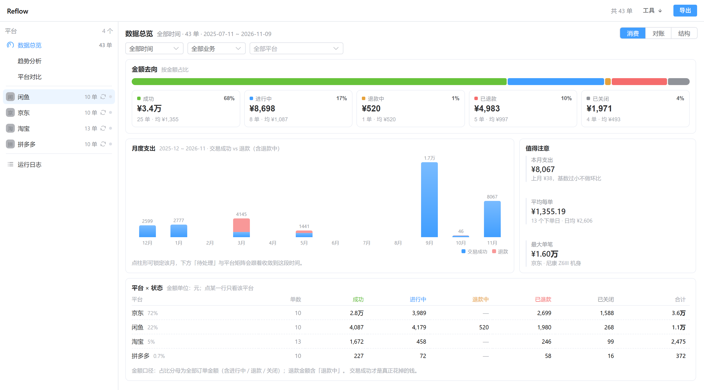
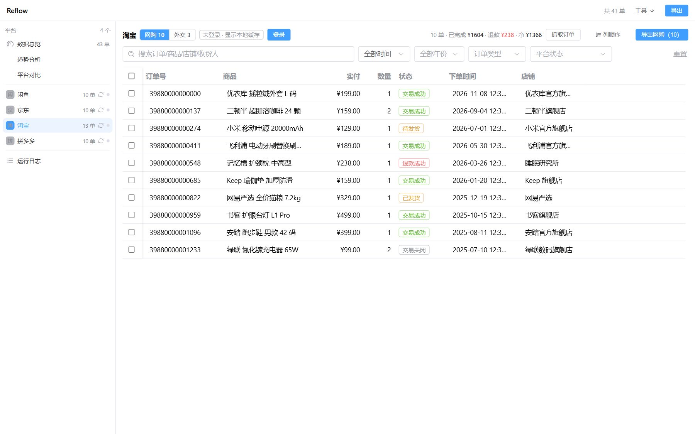
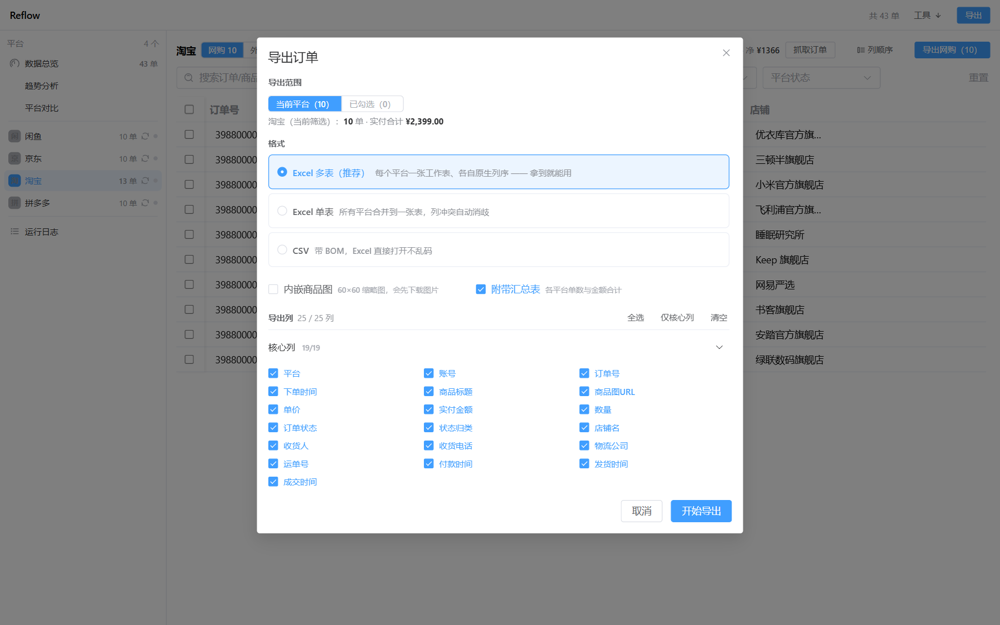

<div align="center">

# Reflow

**Your orders are scattered across Taobao, JD, Pinduoduo and Xianyu — each app shows you three months and calls it history. Reflow pulls them all back into one list you own.**

Local-first order aggregation for Chinese e-commerce accounts. Runs on your machine, stores on your machine, uploads nothing.

[](https://github.com/FaustDream/Reflow/releases/latest)
[](https://github.com/FaustDream/Reflow/actions/workflows/ci.yml)
[](LICENSE)
[](#run-from-source)

<sub>English · [简体中文](README.zh-CN.md)</sub>



</div>

## Install

Grab the installer from [Releases](https://github.com/FaustDream/Reflow/releases/latest):

| System | Download |
|---|---|
| Windows 10/11 | `Reflow-1.0.1-win-x64.exe` (installer) or `Reflow-1.0.1-portable.exe` (no install) |

The builds are **unsigned**, so the OS will block the first launch. That is expected:

- **Windows**: SmartScreen says "Windows protected your PC" → *More info* → *Run anyway*.

Verify integrity against `SHA256SUMS.txt` in the same release (`certutil -hashfile <file> SHA256` on Windows).

## Why

Every platform keeps your purchase history, but only for itself, only for a while, and only in the shape it prefers:

- Taobao and JD hide older orders behind year-by-year paging; Pinduoduo gives you an endless scroll.
- 闲鱼 has no order export at all.
- None of them will answer "how much did I spend on shopping this year, and how much came back as refunds?"
- The order data you generated is yours; you just can't get it out.

Reflow logs in with the QR code you already scan, reads your own orders through the same endpoints the web pages use, and keeps a merged copy on disk — filterable, comparable across platforms, exportable to Excel.

## What you get

| | |
|---|---|
| **Four platforms in one list** | 闲鱼 / 京东 / 淘宝 / 拼多多, merged with a unified order model (19 core columns + platform-specific extras) |
| **One-click capture** | Log in once by QR code, then `抓取订单` fetches in the background — no paging by hand |
| **Dashboard** | 5 KPIs + yearly spend, platform share, monthly distribution, refund gauge, daily heat calendar, weekday and status breakdowns — hand-written SVG, no chart library |
| **Trends & comparison** | Time-dimension view and platform-dimension view over the same dataset |
| **Filter and export** | Filter by year, status, keyword; select rows; export in three shapes with per-platform sheets |
| **Run log** | Live log view inside the app: level filter, keyword search, open log folder |

<div align="center">

</div>

## Supported platforms

| Platform | Capture | Login |
|---|---|---|
| **闲鱼** Xianyu | Page SDK inside a hidden host window (plus passive capture) | QR / web login in a popup |
| **京东** JD | Direct API (`pcorder_center_list`, year-by-year paging); `h5st` sign computed by a hidden host page | QR code extracted from the login page |
| **淘宝** Taobao | Direct `mtop` API, signed locally; 外卖 orders topped up from `asyncBought.htm` | Native QR code |
| **拼多多** Pinduoduo | Direct v4 API with real paging cursor, scroll fallback | QR code extracted from the login page |

美团 / 得物 / 快手小店 / 1688 / 饿了么 were dropped once the platforms closed their web entry points. Some adapters are only hidden, some are deleted — `src/shared/platform-visibility.ts` is the single place that says which.

## How it works

The UI is a Vue 3 app; all privileged work runs in the Electron main process. In a packaged build the two talk over the preload bridge; during source development the UI can also run in a browser and speak loopback HTTP + SSE instead.

```
Renderer  Vue 3 + Element Plus + Pinia
   │   packaged: window.api injected by preload
   │   dev:      POST /api/invoke, GET /api/events (SSE)
   ▼
Electron main   (dev mode also opens a web-bridge at http://127.0.0.1:9478)
   ├── adapters/            per-platform request + parse
   ├── hidden host window/  runs the platform's own page SDK to sign requests
   ├── login (QR)           writes cookies into a persist: partition
   ├── order cache          userData/orders/<platform>.json
   ├── export               xlsx / CSV, optional embedded thumbnails
   └── MITM (optional)      Windows only, off by default
```

The bridge binds to loopback only and has no auth beyond it — do not expose port 9478.

## Run from source

Node.js 22 or newer.

```bash
git clone https://github.com/FaustDream/Reflow.git
cd Reflow
npm ci
npm run dev:web          # then open http://localhost:5173
```

The Electron process starts with the dev server; closing the terminal stops both. On machines with broken GPU drivers (VMs, RDP), an Electron instance started without software rendering can exit silently after ~40 seconds — use `npm run dev:web:sw` instead.

Try it without an account:

```bash
npm run dev:web:demo
```

This prepares an isolated `userData` directory (`%TEMP%/reflow-demo`, never your real one), fills it with synthetic orders, and gives you four platforms' worth of data — enough to exercise filters, the dashboard and the export dialog.

### Build installers yourself

```bash
npm run build:win      # Windows installer + portable
npm run build:mac      # macOS dmg + zip (must run on macOS)
npm run build:linux    # Linux AppImage + deb (must run on Linux)
```

Artifacts land in `dist-release/`. macOS builds get an ad-hoc signature so they actually launch on Apple Silicon.

The release pipeline builds Windows only: pushing a tag produces the installer and the portable exe. The mac/linux commands stay for local use and are not uploaded to a release.

## Data & privacy

- Orders are cached as **plain JSON**, one file per platform: `%APPDATA%\Reflow\orders\<platform>.json` (macOS: `~/Library/Application Support/Reflow`, Linux: `~/.config/Reflow`). Atomic write, field whitelist, **no cookies or tokens inside**.
- Login state lives in Electron's `persist:platform-<id>` partitions, i.e. where Chrome would keep it. Reflow never copies it into the cache or the export.
- The only outbound requests are: the platform's own order endpoints, the platform's login endpoint, and product-image CDNs when you export with thumbnails. There is no telemetry, no analytics, no auto-updater, no cloud sync, no remote config.
- Logs go to `userData/logs/app-YYYY-MM-DD.log` (NDJSON, 7 days, cookie/token values masked).
- The installer and a source run share the same `userData` directory: upgrading in place keeps your cache, uninstalling leaves it alone.

## Known limitations

- **Four platforms only.** Food delivery is no longer a separate platform; Taobao/JD orders still expose a 网购/外卖 split inside the platform page.
- **Platform risk control is outside our control.** A slider or captcha ends the automated path — Reflow tells you to open the page and finish it by hand.
- **APIs are undocumented and change without notice.** A platform shipping a new sign or endpoint breaks capture until the adapter is updated. No SLA.
- **The MITM channel is Windows-only**, requires installing a root certificate, is off by default, and whitelists six domains. It exists as a fallback, not the main path.
- **Order cache is not encrypted.** Anyone with access to your OS user profile can read it — use full-disk encryption if that matters.
- **UI is Chinese-only.** No i18n layer yet.

<div align="center">

</div>

## Contributing

Bug reports, adapter fixes and UI work are welcome — start with [CONTRIBUTING.md](CONTRIBUTING.md). Security issues: please use the private channel described in [SECURITY.md](SECURITY.md), not a public issue.

## Disclaimer

Unofficial tooling, not affiliated with or endorsed by any platform. It reads **your own** account data through the web endpoints your browser already uses, and it deliberately avoids bypassing security mechanisms: signatures are computed by the platform's own page SDK, no certificates are installed unless you explicitly enable MITM, and no admin rights are needed. Scraping may violate a platform's terms of service — that decision, and the account risk that comes with it, is yours. See [LICENSE](LICENSE) for the warranty disclaimer.

## Community

This project recognizes and links to the [LINUX DO](https://linux.do/) community, where releases are announced. Issues and pull requests from the community are welcome.

## License

[MIT](LICENSE) © 2026 FaustDream. Use it, ship it, sell it — just keep the copyright notice.
