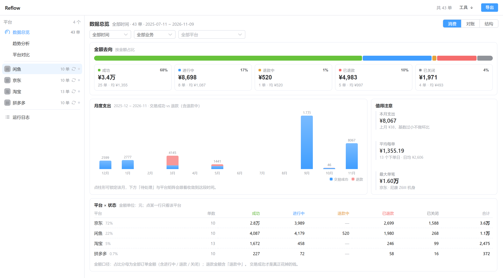
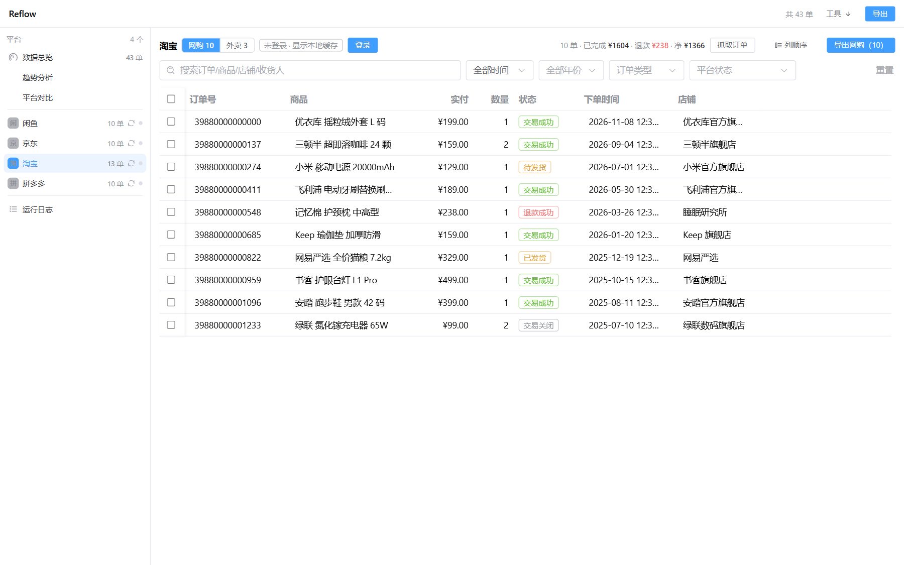
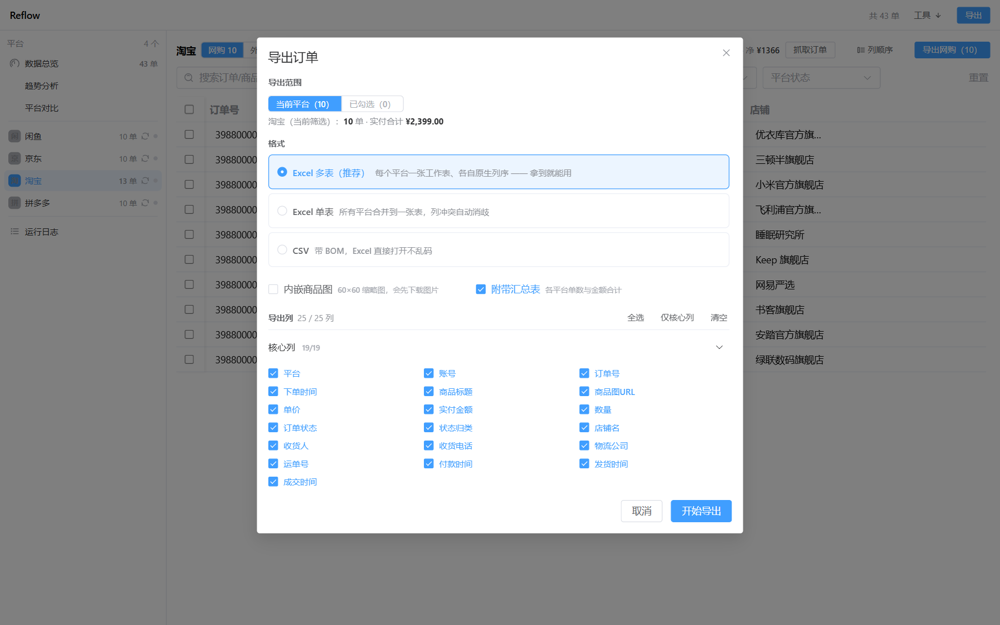

<div align="center">

# Reflow

**订单散落在淘宝、京东、拼多多、闲鱼四个 App 里，每个都只给你看最近三个月，还各用一种排版。Reflow 把它们收回一份属于你自己的清单。**

本地优先的电商订单归集工具：在你自己的机器上运行，数据也留在你自己的机器上，不上传任何内容。

[](https://github.com/FaustDream/Reflow/releases/latest)
[](https://github.com/FaustDream/Reflow/actions/workflows/ci.yml)
[](LICENSE)
[](#从源码运行)

<sub>[English](README.md) · 简体中文</sub>



</div>

## 下载安装

到 [Releases](https://github.com/FaustDream/Reflow/releases/latest) 取对应系统的包：

| 系统 | 下载 |
|---|---|
| Windows 10/11 | `Reflow-1.0.0-win-x64.exe`（安装包）或 `Reflow-1.0.0-portable.exe`（免安装） |
| macOS | `Reflow-1.0.0-mac-arm64.dmg`（Apple Silicon）或 `Reflow-1.0.0-mac-x64.dmg`（Intel） |
| Linux | `Reflow-1.0.0-linux-*.AppImage`（通用）或 `*.deb`（Debian / Ubuntu） |

安装包**未做代码签名**，首次运行会被系统拦一次，这是预期行为：

- **Windows**：SmartScreen 提示「Windows 已保护你的电脑」→「更多信息」→「仍要运行」。
- **macOS**：右键点图标选「打开」；或 `xattr -dr com.apple.quarantine "/Applications/Reflow.app"`。

完整性校验：同一 Release 里附有 `SHA256SUMS.txt`，Windows 用 `certutil -hashfile <文件> SHA256` 比对即可。

## 为什么需要它

每个平台都保存着你的购物记录，但只保存在它自己那里、只保留一段时间、只按它喜欢的样子给你看：

- 淘宝、京东的老订单藏在「按年翻页」后面，拼多多干脆让你无尽滚动；
- 闲鱼根本没有订单导出；
- 没有一个平台能回答「今年网购花了多少、其中多少退回来了」；
- 这些订单是你买的，但你就是拿不出来。

Reflow 用你平时也要扫的二维码登录，走网页版自己用的那套接口读**你自己**的订单，在本机合并成一份可以筛选、可以跨平台对比、可以导出 Excel 的数据。

## 你能得到什么

| | |
|---|---|
| **四个平台一张表** | 闲鱼 / 京东 / 淘宝 / 拼多多，统一到同一套订单模型：19 个核心列 + 平台扩展列 |
| **一键抓取** | 扫码登录一次，之后点「抓取订单」后台跑完，不用手点翻页 |
| **数据总览** | 5 个 KPI + 年度分布、平台占比、月度分布、退款仪表、每日热力、周内分布、状态分布；图表全部手写 SVG，不引图表库 |
| **趋势分析 / 平台对比** | 同一份数据的两个视角：按时间看走势，按平台看结构 |
| **筛选与导出** | 年份 / 状态 / 关键词筛选，可勾选，导出三种形态，支持按平台分 Sheet |
| **运行日志** | 界面内实时看日志，可过滤级别、搜关键词、打开日志目录 |

<div align="center">

</div>

## 支持的平台

| 平台 | 抓取方式 | 登录方式 |
|---|---|---|
| **闲鱼** | 隐藏宿主页里跑平台自己的页面 SDK（另有被动捕获兜底） | 弹窗内扫码 / 网页登录 |
| **京东** | 接口直连（`pcorder_center_list` 按年翻页），`h5st` 签名由隐藏宿主页计算 | 从登录页提取二维码 |
| **淘宝** | `mtop` 接口直连，本地签名；外卖单由 `asyncBought.htm` 补抓 | 原生二维码 |
| **拼多多** | v4 接口直连（真实分页游标）+ 滚动补全 | 从登录页提取二维码 |

美团、得物、快手小店、1688、饿了么在平台关闭网页入口后已下架。有的只是隐藏、有的已删除代码 —— 以 `src/shared/platform-visibility.ts` 为准。

## 它是怎么跑的

界面是普通的 Vue 3 应用；所有需要权限的活由 Electron 主进程完成。安装包里两者通过 preload 桥通信，源码开发时也可让界面跑在浏览器里、改走环回 HTTP + SSE。

```
渲染层  Vue 3 + Element Plus + Pinia
   │   安装包：preload 注入 window.api
   │   开发时：POST /api/invoke、GET /api/events（SSE）
   ▼
Electron 主进程   （开发模式下另开 http://127.0.0.1:9478 的 web-bridge）
   ├── adapters/            各平台的请求与解析
   ├── 隐藏宿主页            跑平台自己的页面 SDK 来算 sign
   ├── 登录（扫码）          写进 persist: 分区的 Cookie
   ├── 订单缓存              userData/orders/<platform>.json
   ├── 导出                  xlsx / CSV，可选内嵌商品缩略图
   └── MITM（可选）          仅 Windows，默认关闭
```

web-bridge 只监听环回地址、环回以外没有鉴权 —— 不要把 9478 端口暴露出去。

## 从源码运行

需要 Node.js 22 或更高。

```bash
git clone https://github.com/FaustDream/Reflow.git
cd Reflow
npm ci
npm run dev:web          # 浏览器打开 http://localhost:5173
```

Electron 主进程随 dev server 一起启动，关掉终端即全部结束。在 GPU 驱动异常的机器上（虚拟机、远程桌面），Electron 可能启动约 40 秒后静默退出，改用 `npm run dev:web:sw`（固定软件渲染参数）。

没有平台账号也能看界面：

```bash
npm run dev:web:demo
```

它会准备一个隔离的 `userData` 目录（`%TEMP%/reflow-demo`，绝不碰你的真实目录），写进四个平台的合成订单，足够把筛选、总览和导出对话框都点一遍。

### 自己打包

```bash
npm run build:win      # Windows 安装包 + 免安装版
npm run build:mac      # macOS dmg + zip（须在 macOS 上执行）
npm run build:linux    # Linux AppImage + deb（须在 Linux 上执行）
```

产物落在 `dist-release/`。macOS 的包会用 ad-hoc 签名兜底，保证 Apple Silicon 上能启动。

## 数据与隐私

- 订单以**明文 JSON** 缓存在 `%APPDATA%\Reflow\orders\<platform>.json`（macOS：`~/Library/Application Support/Reflow`，Linux：`~/.config/Reflow`）。原子写入、字段白名单，**不含 Cookie 或令牌**。
- 登录态放在 Electron 的 `persist:platform-<id>` 分区里，也就是 Chrome 会放的位置；Reflow 不会把它复制进缓存或导出文件。
- 全部出网请求只有三类：平台的订单接口、平台的登录接口、导出内嵌缩略图时下载商品图。没有遥测、没有统计、没有自动更新、没有云同步、没有远程配置。
- 日志写在 `userData/logs/app-YYYY-MM-DD.log`（NDJSON，保留 7 天，Cookie / 令牌值打码）。
- 安装包与源码运行共用同一个 `userData` 目录，覆盖安装不会丢订单缓存；卸载不删除用户数据。

## 已知限制

- **只有四个平台。** 外卖不再单列，淘宝、京东的订单里保留页内「网购 / 外卖」分栏。
- **平台风控不受控制。** 遇到滑块或验证码，自动链路就到此为止 —— Reflow 会提示你打开页面人工完成。
- **接口没有文档，随时会变。** 平台换个签名或换个端点，抓取就会失效，直到适配器跟上。没有 SLA。
- **MITM 通道仅 Windows**，需要安装根证书，默认关闭，白名单只有六个域名。它是兜底手段，不是主路径。
- **订单缓存不加密。** 能进你系统账户的人就能读它，介意的话请开启全盘加密。
- **界面只有中文。** 还没有 i18n 层。

<div align="center">

</div>

## 参与贡献

欢迎提 Bug、修适配器、改界面 —— 先看 [CONTRIBUTING.md](CONTRIBUTING.md)（怎么跑、怎么测、PR 要满足什么）。安全问题请走私密渠道，见 [SECURITY.md](SECURITY.md)，不要开公开 Issue。

## 免责声明

非官方工具，与任何电商平台都没有关联或背书。它只读取**你自己**账号的数据，走的是你浏览器本来就在走的接口，并且刻意避开绕过安全机制的做法：签名交给平台自己的页面 SDK 计算，除非你显式开启 MITM 否则不安装任何证书，也不需要管理员权限。抓取行为可能违反平台的服务条款 —— 这个判断以及随之而来的账号风险由你承担。担保免责条款见 [LICENSE](LICENSE)。

## 许可

[MIT](LICENSE) © 2026 FaustDream。随便用、可商用、可闭源分发，保留版权声明即可。
